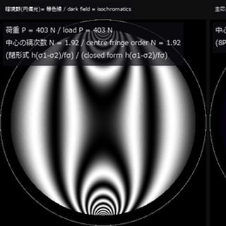
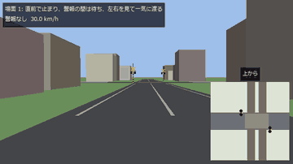

<div class="vlang" markdown="1">

[日本語](../index.md) · [English](../en/index.md) · [简体中文](../zh/index.md) · **繁體中文** · [한국어](../ko/index.md) · [Deutsch](../de/index.md) · [हिन्दी](../hi/index.md) · [Français](../fr/index.md)

</div>

# Fullseye — ViEW2026

**發表:2026 年 12 月 3 日(週四)14:40–15:50(日本時間),互動場次 2,IS2-19**(橫濱 Pacifico,Annex Hall)

<div class="vintro"><div class="vt"><p>Fullseye 是影像檢測、三維量測與物理模擬的平台。透過 MCP 與 RAG,把型別化的古典影像處理運算子與包含光學設計等感測在內的物理模擬交給 AI,讓它針對每個課題思考組合方式,並在型別一致性檢查以及對照物理與成像模擬產生的真值的評估下,以對話方式解決課題。開放原始碼(Apache-2.0)。</p></div></div>

點按圖塊即可開啟影片或圖(▶ = 動態)。

本頁只展示 30 件展品。其餘 286 件在[附加頁](more.md)。

<style>
.vlang { font-size: 14px; line-height: 2; }
.vg { display: grid; grid-template-columns: repeat(2, minmax(0, 1fr)); gap: 8px; margin: 12px 0 20px; }
.vg.vs { grid-template-columns: repeat(3, minmax(0, 1fr)); gap: 6px; }
@media (min-width: 600px) { .vg { grid-template-columns: repeat(3, minmax(0, 1fr)); } .vg.vs { grid-template-columns: repeat(5, minmax(0, 1fr)); } }
@media (min-width: 900px) { .vg { grid-template-columns: repeat(4, minmax(0, 1fr)); } .vg.vs { grid-template-columns: repeat(7, minmax(0, 1fr)); } }
.vg a, .vser a { display: block; position: relative; text-decoration: none; color: inherit; }
.vg img { display: block; width: 100%; max-width: 100%; height: auto; aspect-ratio: 1 / 1; object-fit: cover; border-radius: 6px; background: #222; }
.vg picture { display: block; width: 100%; aspect-ratio: 1 / 1; overflow: hidden; border-radius: 6px; background: #fff; }
.vg picture img { height: 100%; aspect-ratio: auto; object-fit: contain; border-radius: 0; background: #fff; }
.vg b { position: absolute; top: 6px; right: 6px; background: rgba(0,0,0,.6); color: #fff; font-size: 12px; padding: 1px 6px; border-radius: 9px; }
.vg span { display: block; font-size: 13px; line-height: 1.3; margin-top: 3px; }
.vg.vs span { font-size: 11px; }
.vser { display: grid; grid-template-columns: repeat(2, minmax(0, 1fr)); gap: 8px; margin: 12px 0 20px; }
@media (min-width: 600px) { .vser { grid-template-columns: repeat(3, minmax(0, 1fr)); } }
.vser img { display: block; width: 100%; max-width: 100%; height: auto; aspect-ratio: 16 / 9; object-fit: cover; border-radius: 8px; background: #222; }
.vser strong { display: block; font-size: 14px; margin-top: 3px; line-height: 1.3; }
.vser span { display: block; font-size: 12px; line-height: 1.3; }
details.vall { margin: 6px 0; }
details.vall > summary { font-size: 15px; padding: 6px 0; cursor: pointer; }
.vl li { margin-bottom: 8px; }
li, p, code { overflow-wrap: anywhere; }
.vintro { display: flex; gap: 20px; align-items: flex-start; margin: 14px 0; }
.vintro img { flex: 0 0 300px; width: 300px; max-width: 100%; height: auto; border-radius: 6px; }
.vintro .vt p { margin: 0 0 8px; }
.vc { display: flex; gap: 16px; align-items: flex-start; margin: 18px 0; }
.vc > a:first-child { flex: 0 0 260px; position: relative; display: block; text-decoration: none; color: inherit; }
.vc > a img { display: block; width: 100%; max-width: 100%; height: auto; aspect-ratio: 1 / 1; object-fit: cover; border-radius: 6px; background: #222; }
.vc > a picture { display: block; width: 100%; aspect-ratio: 1 / 1; overflow: hidden; border-radius: 6px; background: #fff; }
.vc > a picture img { height: 100%; aspect-ratio: auto; object-fit: contain; border-radius: 0; background: #fff; }
.vc > a b { position: absolute; top: 6px; right: 6px; background: rgba(0,0,0,.6); color: #fff; font-size: 12px; padding: 1px 6px; border-radius: 9px; }
.vc > a .vtb { position: absolute; left: 6px; bottom: 6px; max-width: calc(100% - 12px); background: rgba(0,0,0,.66); color: #fff; font-size: 12px; font-style: normal; line-height: 1.4; padding: 1px 7px; border-radius: 9px; }
.vt { flex: 1 1 auto; min-width: 0; }
.vt .vh { font-size: 17px; font-weight: 600; line-height: 1.4; margin: 0 0 6px; }
.vt p { margin: 0 0 6px; }
.vt .vm { font-size: 14px; color: #57606a; }
.vt details { font-size: 14px; margin: 4px 0; }
.vt summary { cursor: pointer; }
.vc.vv { margin: 10px 0; }
.vc.vv > a:first-child { flex-basis: 96px; }
@media (max-width: 600px) {
  .vintro { flex-direction: column-reverse; gap: 8px; }
  .vintro img { flex: 0 0 auto; width: 100%; max-width: 240px; }
  .vc { flex-direction: column; gap: 8px; }
  .vc > a:first-child { flex: 0 0 auto; width: 240px; max-width: 100%; }
  .vc.vv { flex-direction: row; gap: 12px; }
  .vc.vv > a:first-child { width: 80px; flex: 0 0 80px; }
}
</style>

## 親手試試

可以親手操作論文中的圖(手機上也能用)。用分頁切換方法,3-D 視圖可拖曳旋轉。

<div class="vc vv"><a class="vvi" href="../viewers/poc_cad_scan_deviation.html?lang=tw"></a><div class="vt"><div class="vh"><a href="../viewers/poc_cad_scan_deviation.html?lang=tw">CAD 與實測點雲的偏差檢查</a></div><p>對位會吸收缺陷:真值為 1.2 µm 的零件上出現了 121 µm 並不存在的凹坑。</p></div></div>

<div class="vc vv"><a class="vvi" href="../viewers/poc_photoelasticity.html?lang=tw"></a><div class="vt"><div class="vh"><a href="../viewers/poc_photoelasticity.html?lang=tw">光彈應力</a></div><p>轉動檢偏器會移動光彈性條紋，圓盤內的平均亮度隨之變化（0–135° 範圍）</p></div></div>

<div class="vc vv"><a class="vvi" href="../viewers/poc_polarization_specular.html?lang=tw"></a><div class="vt"><div class="vh"><a href="../viewers/poc_polarization_specular.html?lang=tw">偏光去鏡面反射</a></div><p>偏光可去除鏡面反光;殘留部分隨入射角變化,在布魯斯特角附近最小(掃描使用合成條紋場景)</p></div></div>

## 重點展示

<div class="vc"><a href="../../articles/assets/poc/poc_industrial_oct/01_real_paint_bscans.png"><picture><source media="(prefers-reduced-motion: reduce)" srcset="../../articles/assets/poc/poc_industrial_oct/01_real_paint_bscans.png"></picture><i class="vtb">真值: 實測資料</i></a><div class="vt"><div class="vh"><a href="../../articles/assets/poc/poc_industrial_oct/01_real_paint_bscans.png">不切割量測塗層厚度(工業 OCT)</a></div><p>無需切割即可從深度方向觀察油漆與薄膜層。根據公開的汽車油漆原始光譜量得的透明塗層厚度，與同一板件的顯微鏡讀值相差不超過 3.6 µm。與論文的 OCT 結果吻合只是在重現同一資料，薄到無法分離的層不輸出數值。</p><p class="vm">真值: 實測資料 · <a href="more.html#d-poc-industrial-oct">詳情</a></p></div></div>

<div class="vc"><a href="../../articles/assets/poc/poc_phase_measuring_deflectometry/03_photo_vs_pmd.png"><picture><source media="(prefers-reduced-motion: reduce)" srcset="../../articles/assets/poc/poc_phase_measuring_deflectometry/03_photo_vs_pmd.png"></picture><i class="vtb">真值: 自製合成資料</i></a><div class="vt"><div class="vh"><a href="../../articles/assets/poc/poc_phase_measuring_deflectometry/03_photo_vs_pmd.png">漫射照明照片中看不見的凹痕出現在條紋鏡像中(合成)</a></div><p>光澤漆面上很淺的凹痕在漫射光照片中幾乎看不見。在朝向表面的螢幕上投射條紋，讀取其鏡像的彎曲即可得到曲率，並讓預設的深 3 µm 凹痕清楚顯現。這是合成場景，未與斜射光照片比較。</p><p class="vm">真值: 自製合成資料 · <a href="more.html#d-poc-phase-measuring-deflectometry">詳情</a></p></div></div>

<div class="vc"><a href="../../articles/assets/poc/poc_thin_film_reflectometry/01_real_micrograph_thickness.png"><picture><source media="(prefers-reduced-motion: reduce)" srcset="../../articles/assets/poc/poc_thin_film_reflectometry/01_real_micrograph_thickness.png"></picture><i class="vtb">真值: 實測資料</i></a><div class="vt"><div class="vh"><a href="../../articles/assets/poc/poc_thin_film_reflectometry/01_real_micrograph_thickness.png">從顯微影像顏色讀取氧化層厚度</a></div><p>矽上氧化層的厚度可從反射光中的干涉條紋與顏色讀取。逐像素讀取他人發表的真實顯微影像後，中心值為 87.4 nm。該值比從論文推得的參考值低約十分之一，而且相機的色彩靈敏度未知。</p><p class="vm">真值: 實測資料 · <a href="more.html#d-poc-thin-film-reflectometry">詳情</a></p></div></div>

<div class="vc"><a href="../../articles/assets/poc/poc_registration_basin/06_real_scan_icp.mp4"><picture><source media="(prefers-reduced-motion: reduce)" srcset="../../articles/assets/poc/poc_registration_basin/07_real_scan_still.png"></picture><b>&#9654;</b><i class="vtb">真值: 實測資料</i></a><div class="vt"><div class="vh"><a href="../../articles/assets/poc/poc_registration_basin/06_real_scan_icp.mp4">真實深度下 ICP 收斂域變窄</a></div><p>在一個實測零件與一個合成支架上，我們測試了配準能從多遠的初始位置回到同一終點。在不同隨機種子與交叉規則下，成功率減半的角度比使用全周點時最多提前 31.5 度。終點本身偏離真值，因此量測的是復原範圍而非姿態精度。</p><p class="vm">真值: 實測資料 · <a href="more.html#d-poc-registration-basin">詳情</a></p></div></div>

<div class="vc"><a href="../../articles/assets/poc/poc_hyperspectral_foreign_matter/04_real_pork_belly.png"><picture><source media="(prefers-reduced-motion: reduce)" srcset="../../articles/assets/poc/poc_hyperspectral_foreign_matter/01_real_polymer_flakes.png"></picture><i class="vtb">真值: 實測資料</i></a><div class="vt"><div class="vh"><a href="../../articles/assets/poc/poc_hyperspectral_foreign_matter/04_real_pork_belly.png">用近紅外光譜成像尋找豬五花肉上的異物</a></div><p>公開的真實影像被當作近紅外光譜資料，用來分類豬五花肉上的碎屑。在不同拍攝影像上逐像素評分時，以 1.1 % 的誤報率檢出了大部分碎屑。減少波段會增加誤報，而彩色相機無法辨識同色異物這一點僅由合成資料展示。</p><p class="vm">真值: 實測資料 · <a href="more.html#d-poc-hyperspectral-foreign-matter">詳情</a></p></div></div>

<div class="vc"><a href="../../articles/assets/poc/poc_cad_scan_deviation/14_align_orbit.gif"><picture><source media="(prefers-reduced-motion: reduce)" srcset="../../articles/assets/poc/poc_cad_scan_deviation/01_scene.png"></picture><b>&#9654;</b><i class="vtb">真值: 自製合成資料</i></a><div class="vt"><div class="vh"><a href="../../articles/assets/poc/poc_cad_scan_deviation/14_align_orbit.gif">對齊方式決定零件何處看似超差：CAD 與掃描(合成)</a></div><p>將掃描與設計對齊會吸收一部分偏差，並移動看似超差的位置。在具有已知翹曲的零件上，真偏差很小的中心出現了深 121 µm 的讀值。這是合成結果，而且用取樣點表示設計時，即使無缺陷對照件的邊緣也會顯示超差。</p><p class="vm">真值: 自製合成資料 · <a href="more.html#d-poc-cad-scan-deviation">詳情</a></p></div></div>

<div class="vc"><a href="../../articles/assets/poc/poc_fourier_ptychography/01_usaf_4x_fp_20x.png"><picture><source media="(prefers-reduced-motion: reduce)" srcset="../../articles/assets/poc/poc_fourier_ptychography/01_usaf_4x_fp_20x.png"></picture><i class="vtb">真值: 自製合成資料</i></a><div class="vt"><div class="vh"><a href="../../articles/assets/poc/poc_fourier_ptychography/01_usaf_4x_fp_20x.png">4 倍物鏡達到單色平行光照明下 20 倍物鏡的解析度(傅立葉疊層成像,合成)</a></div><p>低倍物鏡視野寬，但會漏掉精細細節。在合成圖卡上，將多角度照明的影像在頻率空間拼接後，達到了單色平行光下 20x 物鏡的解析能力。在一般光照下，該物鏡仍能解析更細的細節，而照明重疊不足時不傳回答案。</p><p class="vm">真值: 自製合成資料 · <a href="more.html#d-poc-fourier-ptychography">詳情</a></p></div></div>

<div class="vc"><a href="../../articles/assets/poc/poc_itof_multifreq/12_public_raw_unwrap.png"><picture><source media="(prefers-reduced-motion: reduce)" srcset="../../articles/assets/poc/poc_itof_multifreq/01_warehouse_unwrap.png"></picture><i class="vtb">真值: 自製合成資料</i></a><div class="vt"><div class="vh"><a href="../../articles/assets/poc/poc_itof_multifreq/12_public_raw_unwrap.png">間接 ToF 深度在何處失效(合成)</a></div><p>間接 ToF 相機根據調變光的相位延遲量測距離。在合成訊號上，組合三個頻率可讓距離在 18.7 m 以內保持無歧義。多路徑與物體邊緣會使距離在毫無警告下跳變。</p><p class="vm">真值: 自製合成資料 · <a href="more.html#d-poc-itof-multifreq">詳情</a></p></div></div>

<div class="vc"><a href="../../articles/assets/poc/poc_telecentric_metrology/08_real_alignment_plate.png"><picture><source media="(prefers-reduced-motion: reduce)" srcset="../../articles/assets/poc/poc_telecentric_metrology/08_real_alignment_plate.png"></picture><i class="vtb">真值: 實測資料</i></a><div class="vt"><div class="vh"><a href="../../articles/assets/poc/poc_telecentric_metrology/08_real_alignment_plate.png">在公開遠心影像上量得的放大率與論文值在其自身離散範圍內一致</a></div><p>在一幅影像中，透過一般鏡頭觀察有階差的零件時，越近的部分看起來越大。從公開的遠心鏡頭真實影像量得的放大率與論文一致，但論文本身的數值分散達 ±0.25 %，因此不能把吻合解讀得更精細。傾斜板上的環中心不漂移就是證據。</p><p class="vm">真值: 實測資料 · <a href="more.html#d-poc-telecentric-metrology">詳情</a></p></div></div>

<div class="vc"><a href="../../articles/assets/poc/poc_virtual_sem_kv_cd_bse/05_sem_same_part_3kv_3detectors.png"><picture><source media="(prefers-reduced-motion: reduce)" srcset="../../articles/assets/poc/poc_virtual_sem_kv_cd_bse/05_sem_same_part_3kv_3detectors.png"></picture><i class="vtb">真值: 公開發表的數值</i></a><div class="vt"><div class="vh"><a href="../../articles/assets/poc/poc_virtual_sem_kv_cd_bse/05_sem_same_part_3kv_3detectors.png">虛擬 SEM：影像隨電壓變化(模型以實測背向散射評分)</a></div><p>SEM 影像不是表面的照片，而是電子在固體中散射後逸出的計數。逐一追蹤電子的模型以 7 種元素的實測背向散射資料進行核對。由於沒有線寬已知的真實影像，線寬讀值隨束流能量變化的結果只在模型內成立。</p><p class="vm">真值: 公開發表的數值 · <a href="more.html#d-poc-virtual-sem-kv-cd-bse">詳情</a></p></div></div>

<div class="vc"><a href="../../articles/assets/poc/poc_real_tum_rgbd_slam/02_trajectory.png"><picture><source media="(prefers-reduced-motion: reduce)" srcset="../../articles/assets/poc/poc_real_tum_rgbd_slam/02_trajectory.png"></picture><i class="vtb">真值: 實測資料</i></a><div class="vt"><div class="vh"><a href="../../articles/assets/poc/poc_real_tum_rgbd_slam/02_trajectory.png">在公開 RGB-D 資料上評估逐幀對齊：誤差為等速猜測的 0.45-0.82 倍，取決於各分割選擇的離群值裁剪(一個 32 幀序列)</a></div><p>在一段公開的桌面深度序列上，逐幀對齊與動作捕捉真值進行了核對。誤差低於未對齊，但相對於等速猜測的改善取決於離群值裁剪方式以及採用 8 種分割中的哪一種。小視窗內的平面殘差隨距離增大，但未能確認平方律。</p><p class="vm">真值: 實測資料 · <a href="more.html#d-poc-real-tum-rgbd-slam">詳情</a></p></div></div>

<div class="vc"><a href="../../articles/assets/poc/poc_good_sample_variation_model/04_visa_explanation.png"><picture><source media="(prefers-reduced-motion: reduce)" srcset="../../articles/assets/poc/poc_good_sample_variation_model/01_band_width_alignment.png"></picture><i class="vtb">真值: 實測資料</i></a><div class="vt"><div class="vh"><a href="../../articles/assets/poc/poc_good_sample_variation_model/04_visa_explanation.png">以良品變異找缺陷:實拍影像上守不住宣稱的誤檢率</a></div><p>一種經典檢測方法從良品學習一般的逐像素變異，並標記超出範圍的部分。這裡依預先宣告的誤報率設定區間，並在 200 幅公開真實影像上評分。對齊比良品數量影響更大，而且宣告的誤報率在真實影像上未能維持。</p><p class="vm">真值: 實測資料 · <a href="more.html#d-poc-good-sample-variation-model">詳情</a></p></div></div>

<div class="vc"><a href="../../articles/assets/poc/poc_real_walnut_cbct/07_geometry_mistakes.png"><picture><source media="(prefers-reduced-motion: reduce)" srcset="../../articles/assets/poc/poc_real_walnut_cbct/07_geometry_mistakes.png"></picture><i class="vtb">真值: 實測資料</i></a><div class="vt"><div class="vh"><a href="../../articles/assets/poc/poc_real_walnut_cbct/07_geometry_mistakes.png">實測 CT：忽略垂直偏移會重建出不同切片，只有外部參考才能揭示錯誤</a></div><p>一顆核桃經真實錐束掃描，並用 FDK 與迭代方法重建。使用 300 幅投影並依作者參考評分時，忽略垂直偏移會重建出不同且離參考更遠的切片。這些資料內部自洽，因此重新投影後的殘差不可能改變。</p><p class="vm">真值: 實測資料 · <a href="more.html#d-poc-real-walnut-cbct">詳情</a></p></div></div>

<div class="vc"><a href="../../articles/assets/poc/poc_bottle_pattern_inverse/01_checker_through_bottle.png"><picture><source media="(prefers-reduced-motion: reduce)" srcset="../../articles/assets/poc/poc_bottle_pattern_inverse/01_checker_through_bottle.png"></picture><i class="vtb">真值: 自製合成資料</i></a><div class="vt"><div class="vh"><a href="../../articles/assets/poc/poc_bottle_pattern_inverse/01_checker_through_bottle.png">從背景條紋反推玻璃瓶(模擬)：共用假設下的復原與不可分離量</a></div><p>透明瓶會扭曲其後方的條紋。我們逐像素確定看到的背景位置，反向擬合瓶身幾何與折射率，並用模擬中 5 種填充狀態的真值評分。無法分離的量也會回報，而且沒有在真實瓶子上核對任何結果。</p><p class="vm">真值: 自製合成資料 · <a href="more.html#d-poc-bottle-pattern-inverse">詳情</a></p></div></div>

<div class="vc"><a href="../../articles/assets/poc/poc_ai_built_inspection_scored/01_crack_real.png"><picture><source media="(prefers-reduced-motion: reduce)" srcset="../../articles/assets/poc/poc_ai_built_inspection_scored/01_crack_real.png"></picture><i class="vtb">真值: 實測資料</i></a><div class="vt"><div class="vh"><a href="../../articles/assets/poc/poc_ai_built_inspection_scored/01_crack_real.png">AI 組裝檢測並在公開真實資料上評分(本地 LLM 在 60 次執行中有 5 次為裂紋建出優於隨機的檢測，對蠟燭污漬則一次也沒有)</a></div><p>一個本地 LLM 接收文字任務，僅透過 MCP 建立檢測流程，並在公開真實影像上評分。只有少數裂紋檢測執行優於隨機，且沒有一次達到單一統計量基準(AUROC 0.999)。蠟燭污漬檢測無一成功，雲端 LLM 的執行條件雖不相同，也仍低於現有流程。</p><p class="vm">真值: 實測資料 · <a href="more.html#d-poc-ai-built-inspection-scored">詳情</a></p></div></div>

<div class="vc"><a href="../../articles/assets/poc/poc_3d_sensor_modalities/01_map.png"><picture><source media="(prefers-reduced-motion: reduce)" srcset="../../articles/assets/poc/poc_3d_sensor_modalities/01_map.png"></picture><i class="vtb">真值: 自製合成資料</i></a><div class="vt"><div class="vh"><a href="../../articles/assets/poc/poc_3d_sensor_modalities/01_map.png">在一個零件上模擬五種 3-D 感測方法：各方法因材料而失效之處</a></div><p>在此模擬中，數種深度感測方法的模型量測同一零件的霧面、亮面金屬、半透明與黑色材質版本。形狀誤差以統一的 0.1 mm 標尺計數，並與尺寸表比較。各方法的解析度相差數個數量級，因此應看各自在哪裡失效，而不是看排名。</p><p class="vm">真值: 自製合成資料 · <a href="more.html#d-poc-3d-sensor-modalities">詳情</a></p></div></div>

## 推薦展示

<div class="vc"><a href="../../articles/assets/poc/poc_photoelasticity/03_load_and_isoclinics.mp4"><picture><source media="(prefers-reduced-motion: reduce)" srcset="../../articles/assets/poc/poc_photoelasticity/01_polariscope.png"></picture><b>&#9654;</b><i class="vtb">真值: 自製合成資料</i></a><div class="vt"><div class="vh"><a href="../../articles/assets/poc/poc_photoelasticity/03_load_and_isoclinics.mp4">受壓圓盤中的應力顯示為條紋(光彈性，合成)</a></div><p>透過偏光片觀察時，受力透明塑膠的內部應力顯示為條紋。從偏光影像復原受壓圓盤的應力，即使在條紋級次超過 0.5 且相位纏繞之處也是如此。解纏繞後的多數誤差落在早已知曉的符號翻轉處，而非纏繞處。</p><p class="vm">真值: 自製合成資料 · <a href="more.html#d-poc-photoelasticity">詳情</a></p></div></div>

<div class="vc"><a href="../../articles/assets/poc/poc_equipment_selection_map/02_equipment_at_a_glance.png"><picture><source media="(prefers-reduced-motion: reduce)" srcset="../../articles/assets/poc/poc_equipment_selection_map/02_equipment_at_a_glance.png"></picture><i class="vtb">真值: 自製合成資料</i></a><div class="vt"><div class="vh"><a href="../../articles/assets/poc/poc_equipment_selection_map/02_equipment_at_a_glance.png">設備圖譜：同一缺陷在 60 組光源、相機與鏡頭中的表現(合成測試)</a></div><p>我們用同一缺陷預先測試了外觀檢測設備。透過 60 種照明、相機與鏡頭組合，我們繪製了能檢出的最小缺陷及其重複試驗離散範圍。這是合成測試，不代表真實設備的效能。</p><p class="vm">真值: 自製合成資料 · <a href="more.html#d-poc-equipment-selection-map">詳情</a></p></div></div>

<div class="vc"><a href="../../articles/assets/poc/poc_real_stereo_multiscanline/02_failure_map.png"><picture><source media="(prefers-reduced-motion: reduce)" srcset="../../articles/assets/poc/poc_real_stereo_multiscanline/02_failure_map.png"></picture><i class="vtb">真值: 實測資料</i></a><div class="vt"><div class="vh"><a href="../../articles/assets/poc/poc_real_stereo_multiscanline/02_failure_map.png">用真實立體像對求視差、曲面與圓的位姿</a></div><p>使用一對真實立體影像，我們計算視差、距離、表面，甚至圓的姿態。結果依 Middlebury 2014 提供的真值視差評分，並與 OpenCV 比較。在雙方均有效的像素上，兩者大致相當，大部分差距來自各自將哪些像素判為無效。</p><p class="vm">真值: 實測資料 · <a href="more.html#d-poc-real-stereo-multiscanline">詳情</a></p></div></div>

<div class="vc"><a href="../../articles/assets/poc/poc_polarization_specular/09_glare_removed_label.png"><picture><source media="(prefers-reduced-motion: reduce)" srcset="../../articles/assets/poc/poc_polarization_specular/01_raw_polarizer_mosaic.png"></picture><i class="vtb">真值: 自製合成資料</i></a><div class="vt"><div class="vh"><a href="../../articles/assets/poc/poc_polarization_specular/09_glare_removed_label.png">偏光可消除 90 % 的薄膜反光,此照明下一片固定偏光濾鏡就夠(合成)</a></div><p>每個像素帶偏光片的相機把亮膜後的標籤分解為漫射與眩光分量。約 90 % 的眩光被去除，但在此光照下，固定偏光濾鏡對印字的讀取更好。只有光源更寬時該相機才能追平；場景為合成，未與真實影像核對。</p><p class="vm">真值: 自製合成資料 · <a href="more.html#d-poc-polarization-specular">詳情</a></p></div></div>

<div class="vc"><a href="../../articles/assets/poc/poc_solar_el_inspection/10_real_el_overlay.png"><picture><source media="(prefers-reduced-motion: reduce)" srcset="../../articles/assets/poc/poc_solar_el_inspection/15_real_cover.png"></picture><i class="vtb">真值: 公開的實測資料(真值為 I-V 實測)</i></a><div class="vt"><div class="vh"><a href="../../articles/assets/poc/poc_solar_el_inspection/10_real_el_overlay.png">太陽能電池片的真實 EL 影像:遮光遮罩的暗區跟隨功率損失,整片變暗的缺陷則不跟隨</a></div><p>在真實電池片的公開 EL 影像上，將暗區面積的排序與 I-V 曲線量得的功率損失排序比較。對合成電池有效的柵線劃分會一併抹去邊緣條帶遮罩，重新調校的版本也沒有明顯優於只用平均亮度(秩相關 0.57)。當整片電池變暗時，任何面積計數都不能跟隨損失。</p><p class="vm">真值: 公開的實測資料(真值為 I-V 實測) · <a href="more.html#d-poc-solar-el-inspection">詳情</a></p></div></div>

<div class="vc"><a href="../../articles/assets/poc/poc_interferometry_step/09_csi_scan_explained.mp4"><picture><source media="(prefers-reduced-motion: reduce)" srcset="../../articles/assets/poc/poc_interferometry_step/01_surface_interferograms.png"></picture><b>&#9654;</b><i class="vtb">真值: 自製合成資料</i></a><div class="vt"><div class="vh"><a href="../../articles/assets/poc/poc_interferometry_step/09_csi_scan_explained.mp4">以白光干涉測奈米級台階(合成)</a></div><p>在合成掃描中，重新量測了白光干涉儀從條紋對比峰值讀取的階差。單次量測的離散標準差至少為 10.5 nm，而重複量測平均值中殘留的偏差淹沒在雜訊裡。掃描步長過粗時，即使沒有雜訊也會殘留誤差。</p><p class="vm">真值: 自製合成資料 · <a href="more.html#d-poc-interferometry-step">詳情</a></p></div></div>

<div class="vc"><a href="../../articles/assets/poc/poc_tdi_linescan/11_tdi_1_vs_64_closeup.png"><picture><source media="(prefers-reduced-motion: reduce)" srcset="../../articles/assets/poc/poc_tdi_linescan/01_tdi_stages_defects.png"></picture><i class="vtb">真值: 自製合成資料</i></a><div class="vt"><div class="vh"><a href="../../articles/assets/poc/poc_tdi_linescan/11_tdi_1_vs_64_closeup.png">在暗的產線上疊加 TDI 級數,淺傷浮現(合成)</a></div><p>移動的薄膜或鋼帶用線陣感測器成像。在植入微弱缺陷的合成鋼帶與典型感測器模型上，將暗線上的曝光疊加 64 級後，淹沒在雜訊中的缺陷清楚顯現。若輸送與擷取不同步，疊加影像就會拖影。</p><p class="vm">真值: 自製合成資料 · <a href="more.html#d-poc-tdi-linescan">詳情</a></p></div></div>

<div class="vc"><a href="../../articles/assets/poc/poc_illumination_cone_vs_na/07_cone_cover.png"><picture><source media="(prefers-reduced-motion: reduce)" srcset="../../articles/assets/poc/poc_illumination_cone_vs_na/07_cone_cover.png"></picture><i class="vtb">真值: 自製合成資料</i></a><div class="vt"><div class="vh"><a href="../../articles/assets/poc/poc_illumination_cone_vs_na/07_cone_cover.png">照明光錐的張角決定凹痕與刮傷是否可見(合成)</a></div><p>對於近似鏡面的金屬，每個光錐的寬度與軸向可讓淺凹痕和髮絲刮痕顯現或消失。在均勻光錐的合成設定中，4° 的光錐半角隱藏了髮絲紋，只留下刮痕呈暗色。這是設備圖譜背後的物理機制，尚未與真實照片核對。</p><p class="vm">真值: 自製合成資料 · <a href="more.html#d-poc-illumination-cone-vs-na">詳情</a></p></div></div>

<div class="vc"><a href="../../articles/assets/poc/poc_real_defect_floor/03_defect_floor_explained.mp4"><b>&#9654;</b><i class="vtb">真值: 實拍背景</i></a><div class="vt"><div class="vh"><a href="../../articles/assets/poc/poc_real_defect_floor/03_defect_floor_explained.mp4">雜訊匹配後，真實背景上的微弱缺陷檢測極限仍比合成背景差 2.03-3.47 倍</a></div><p>檢測團隊常用平坦背景加雜訊的合成影像估計能捕捉到多弱的缺陷。即使雜訊匹配，每種真實背景也都使檢測極限升至合成背景的至少 2.03 倍。決定極限的不是雜訊，而是灰縫等背景結構。</p><p class="vm">真值: 實拍背景 · <a href="more.html#d-poc-real-defect-floor">詳情</a></p></div></div>

<div class="vc"><a href="../../articles/assets/poc/poc_mixed_case_depalletizing/08_depal_robot_video.mp4"><picture><source media="(prefers-reduced-motion: reduce)" srcset="../../articles/assets/poc/poc_mixed_case_depalletizing/01_overview_same_pattern.png"></picture><b>&#9654;</b><i class="vtb">真值: 自製合成資料</i></a><div class="vt"><div class="vh"><a href="../../articles/assets/poc/poc_mixed_case_depalletizing/08_depal_robot_video.mp4">混裝紙箱：深度階差、V 形槽或色彩槽(模擬)</a></div><p>在模擬場景中，外觀相似的紙箱透過頂部深度與彩色影像區分，然後卸下。深度階差一個也分不開，而深度凹陷或深色線條勝出，會隨 28 種折蓋接縫結構而變化。印刷相同時，深槽有利於色彩；只有寬大、無膠帶的切口位於淺槽上時，深度才占優。</p><p class="vm">真值: 自製合成資料 · <a href="more.html#d-poc-mixed-case-depalletizing">詳情</a></p></div></div>

<div class="vc"><a href="../../articles/assets/poc/poc_tem_ctf_thon_rings/17_real_cover.png"><picture><source media="(prefers-reduced-motion: reduce)" srcset="../../articles/assets/poc/poc_tem_ctf_thon_rings/02_thon_rings_four_defoci.png"></picture><i class="vtb">真值: 實測資料(參考值為作者使用 CTFFIND3 得出的估計值)</i></a><div class="vt"><div class="vh"><a href="../../articles/assets/poc/poc_tem_ctf_thon_rings/17_real_cover.png">從真實電顯影像推定離焦,與作者值相差 0.21 % 以內</a></div><p>在穿透式電子顯微鏡中，離焦會使精細細節的明暗符號反轉。從公開真實顯微影像估計的離焦值與作者自用軟體的結果相差不超過 0.21 %。材料與半導體 TEM 也從相同的同心環讀取焦點，但測試僅使用了公開的生物資料。</p><p class="vm">真值: 實測資料(參考值為作者使用 CTFFIND3 得出的估計值) · <a href="more.html#d-poc-tem-ctf-thon-rings">詳情</a></p></div></div>

<div class="vc"><a href="../../articles/assets/poc/poc_sam_hybrid_bonding_voids/03_amplitude_vs_phase.png"><picture><source media="(prefers-reduced-motion: reduce)" srcset="../../articles/assets/poc/poc_sam_hybrid_bonding_voids/03_amplitude_vs_phase.png"></picture><i class="vtb">真值: 自製合成資料</i></a><div class="vt"><div class="vh"><a href="../../articles/assets/poc/poc_sam_hybrid_bonding_voids/03_amplitude_vs_phase.png">用超音波回波相位尋找接合面空洞(模擬)</a></div><p>此模擬使用掃描聲學顯微鏡尋找堆疊晶片接合面中的微小空洞。尺寸為 16 um 或更大的空洞在回波相位影像中以反相亮點出現。在亮度影像中，許多小空洞混在良好像素之中。</p><p class="vm">真值: 自製合成資料 · <a href="more.html#d-poc-sam-hybrid-bonding-voids">詳情</a></p></div></div>

<div class="vc"><a href="../../articles/assets/poc/poc_lidar_terrain_change/13_real_dod.png"><picture><source media="(prefers-reduced-motion: reduce)" srcset="../../articles/assets/poc/poc_lidar_terrain_change/01_geometry.png"></picture><i class="vtb">真值: 實測資料</i></a><div class="vt"><div class="vh"><a href="../../articles/assets/poc/poc_lidar_terrain_change/13_real_dod.png">兩期航空 LiDAR:不減去系統差,整片都像被挖掉</a></div><p>將同一公園相隔兩年的公開航空 LiDAR 相減，會使整個區域看起來下沉，彷彿全被挖走。依平地上的 0.183 m 偏移對齊後，只剩建築物周圍的變化。在變化覆蓋場景大部分區域的合成斜坡上，對齊會吸收變化本身並使體積崩落。</p><p class="vm">真值: 實測資料 · <a href="more.html#d-poc-lidar-terrain-change">詳情</a></p></div></div>

<div class="vc"><a href="../../articles/assets/poc/poc_moire_alignment/09_overlay_cover.png"><picture><source media="(prefers-reduced-motion: reduce)" srcset="../../articles/assets/poc/poc_moire_alignment/02_one_nm_steps.png"></picture><i class="vtb">真值: 自製合成資料</i></a><div class="vt"><div class="vh"><a href="../../articles/assets/poc/poc_moire_alignment/09_overlay_cover.png">疊加兩片看不見的光柵,以疊紋讀出 nm 級偏移(合成)</a></div><p>微影必須以奈米精度疊合光罩與晶圓。把細到相機無法分辨的光柵疊合會產生條紋，在只有白雜訊的合成測試中，以 0.08 nm 的誤差讀出了奈米級步進。真實對齊精度要粗得多，由標記不對稱與間隙等系統誤差決定，而測試未包含這些因素。</p><p class="vm">真值: 自製合成資料 · <a href="more.html#d-poc-moire-alignment">詳情</a></p></div></div>

## 系列文章 (Qiita 上的英文文章)

<div class="vser">
<a href="https://qiita.com/furuse-kazufumi/items/8a8f23e53b19ee8cdc10"><strong>紙上的量測館</strong><span>自行植入真值的 PoC 展館</span></a>
<a href="https://qiita.com/furuse-kazufumi/items/a82bf9f341cc4f04ca75"><strong>桌球</strong><span>從影片量測彈跳與摩擦</span></a>
<a href="https://qiita.com/furuse-kazufumi/items/05de90f4d316cd7c681c"><strong>自動駕駛</strong><span>以定理與第二實作評分</span></a>
<a href="https://qiita.com/furuse-kazufumi/items/638f0b0aa7865e17c67c"><strong>連接體(腦接線圖)</strong><span>把蒼蠅視覺模型裝到身體上量測</span></a>
<a href="https://qiita.com/furuse-kazufumi/items/569720dbae0c6471c96e"><strong>人形機器人運動會</strong><span>由影像處理擔任裁判的家庭運動會</span></a>
</div>

也請看[附加頁:其他 PoC](more.md)。

<details markdown="1">
<summary><b>試試看</b> (Python 3.11)</summary>

```
pip install fullseye
git clone https://github.com/furuse-kazufumi/fullseye
cd fullseye
python examples/poc_focus_stacking.py
```

景深合成 PoC 約 20 秒跑完,印出相對真值的數字與 `PASS`。圖寫入 `out/figures/poc_focus_stacking/`。

</details>

<details markdown="1">
<summary><b>連結</b></summary>

- [GitHub(原始碼)](https://github.com/furuse-kazufumi/fullseye)
- [圖庫(全部圖)](../../GALLERY.en.md)
- [尋找運算子 / 從 AI(RAG)使用](../../AI_RAG_GUIDE.tw.md) · [從 MCP 使用](../../MCP.md) _(ja)_
- [文件索引](../../README.tw.md)

</details>

<details markdown="1">
<summary><b>論文資訊</b></summary>

- **題目**: Fullseye：型付き演算子と物理シミュレーションに基づく画像検査・三次元計測基盤 _(ja)_ (基於型別化運算子與物理模擬的影像檢測與三維量測平台)
- **作者**: 古瀬 和文(個人研究者)
- **發表**: ViEW2026 視覺技術實際應用研討會
- **論文 PDF**: [English](../paper/101_en.pdf) · [简体中文](../paper/101_zh.pdf)(日本語: 2026-11-26 起公開)

**摘要(由日文翻譯)**: 本文提出開放原始碼平台 Fullseye:把影像檢測與三維量測的處理組裝成宣告了輸入輸出資料型別的運算子鏈,以物理與成像模擬產生的真值進行定量評估,並記錄處理流程、評估與失敗條件以便重複使用。它由約 3,000 個型別化運算子、在執行前拒絕型別不一致的檢查、多語言運算子檢索(RAG)以及 200 多個帶真值的驗證程式組成。本文報告代表例的定量評估,以及合成、實測、實機三個驗證階段的區分。

</details>
