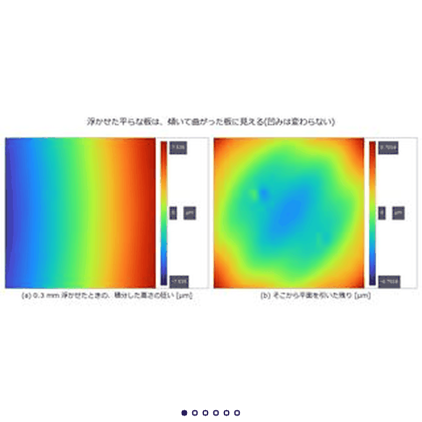
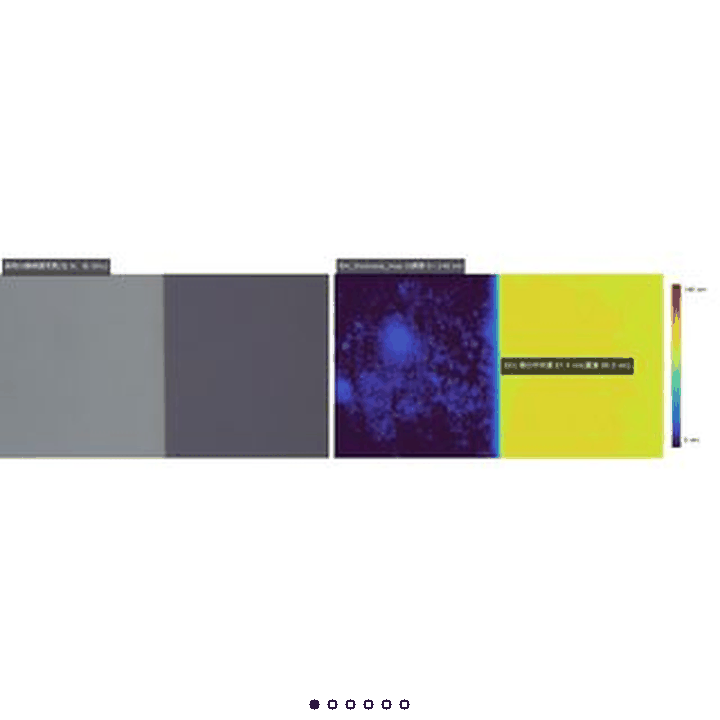
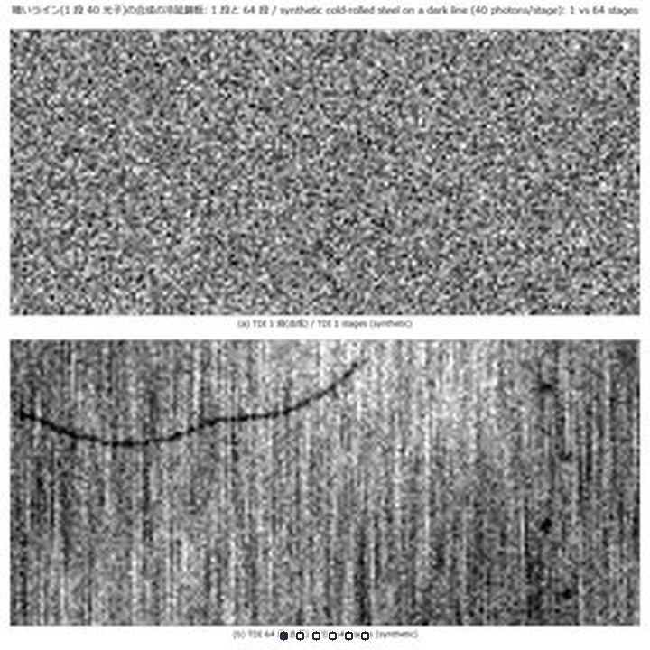
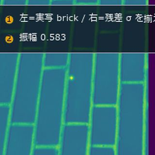

<div class="vlang" markdown="1">

[日本語](../index.md) · [English](../en/index.md) · **简体中文** · [繁體中文](../tw/index.md) · [한국어](../ko/index.md) · [Deutsch](../de/index.md) · [हिन्दी](../hi/index.md) · [Français](../fr/index.md)

</div>

# Fullseye — ViEW2026

**发表:2026 年 12 月 3 日(周四)14:40–15:50(日本时间),互动环节 2,IS2-19**(横滨 Pacifico,Annex Hall)

<div class="vintro"><div class="vt"><p>Fullseye 是图像检测、三维测量与物理仿真的平台。通过 MCP 和 RAG,把类型化的经典图像处理算子与包含光学设计等传感在内的物理仿真交给 AI,让它针对每个课题考虑组合方式,并在类型一致性检查以及对照物理与成像仿真生成的真值的评估下,以对话方式解决课题。开源(Apache-2.0)。</p><p>也可从 C/C++ 调用（预览）：面向开发的 SDK，可将 682 个 op 作为 C 函数调用（通过 pybind11 嵌入 Python；指定已安装 Fullseye 的 Python 环境即可使用）。说明 → <a href="https://github.com/furuse-kazufumi/fullseye/blob/master/docs/C_API.md"><code>C_API.md</code></a></p></div></div>

点按图块即可打开视频或图(▶ = 动态)。

本页只展示 30 件展品。其余 286 件在[附加页](more.md)。

<style>
.vlang { font-size: 14px; line-height: 2; }
.vg { display: grid; grid-template-columns: repeat(2, minmax(0, 1fr)); gap: 8px; margin: 12px 0 20px; }
.vg.vs { grid-template-columns: repeat(3, minmax(0, 1fr)); gap: 6px; }
@media (min-width: 600px) { .vg { grid-template-columns: repeat(3, minmax(0, 1fr)); } .vg.vs { grid-template-columns: repeat(5, minmax(0, 1fr)); } }
@media (min-width: 900px) { .vg { grid-template-columns: repeat(4, minmax(0, 1fr)); } .vg.vs { grid-template-columns: repeat(7, minmax(0, 1fr)); } }
.vg a, .vser a { display: block; position: relative; text-decoration: none; color: inherit; }
.vg img { display: block; width: 100%; max-width: 100%; height: auto; aspect-ratio: 1 / 1; object-fit: cover; border-radius: 6px; background: #222; }
.vg picture { display: block; width: 100%; aspect-ratio: 1 / 1; overflow: hidden; border-radius: 6px; background: #fff; }
.vg picture img { height: 100%; aspect-ratio: auto; object-fit: contain; border-radius: 0; background: #fff; }
.vg b { position: absolute; top: 6px; right: 6px; background: rgba(0,0,0,.6); color: #fff; font-size: 12px; padding: 1px 6px; border-radius: 9px; }
.vg span { display: block; font-size: 13px; line-height: 1.3; margin-top: 3px; }
.vg.vs span { font-size: 11px; }
.vser { display: grid; grid-template-columns: repeat(2, minmax(0, 1fr)); gap: 8px; margin: 12px 0 20px; }
@media (min-width: 600px) { .vser { grid-template-columns: repeat(3, minmax(0, 1fr)); } }
.vser img { display: block; width: 100%; max-width: 100%; height: auto; aspect-ratio: 16 / 9; object-fit: cover; border-radius: 8px; background: #222; }
.vser strong { display: block; font-size: 14px; margin-top: 3px; line-height: 1.3; }
.vser span { display: block; font-size: 12px; line-height: 1.3; }
details.vall { margin: 6px 0; }
details.vall > summary { font-size: 15px; padding: 6px 0; cursor: pointer; }
.vl li { margin-bottom: 8px; }
li, p, code { overflow-wrap: anywhere; }
.vintro { display: flex; gap: 20px; align-items: flex-start; margin: 14px 0; }
.vintro img { flex: 0 0 300px; width: 300px; max-width: 100%; height: auto; border-radius: 6px; }
.vintro .vt p { margin: 0 0 8px; }
.vc { display: flex; gap: 16px; align-items: flex-start; margin: 18px 0; }
.vc > a:first-child { flex: 0 0 260px; position: relative; display: block; text-decoration: none; color: inherit; }
.vc > a img { display: block; width: 100%; max-width: 100%; height: auto; aspect-ratio: 1 / 1; object-fit: cover; border-radius: 6px; background: #222; }
.vc > a picture { display: block; width: 100%; aspect-ratio: 1 / 1; overflow: hidden; border-radius: 6px; background: #fff; }
.vc > a picture img { height: 100%; aspect-ratio: auto; object-fit: contain; border-radius: 0; background: #fff; }
.vc > a b { position: absolute; top: 6px; right: 6px; background: rgba(0,0,0,.6); color: #fff; font-size: 12px; padding: 1px 6px; border-radius: 9px; }
.vc > a .vtb { position: absolute; left: 6px; bottom: 6px; max-width: calc(100% - 12px); background: rgba(0,0,0,.66); color: #fff; font-size: 12px; font-style: normal; line-height: 1.4; padding: 1px 7px; border-radius: 9px; }
.vt { flex: 1 1 auto; min-width: 0; }
.vt .vh { font-size: 17px; font-weight: 600; line-height: 1.4; margin: 0 0 6px; }
.vt p { margin: 0 0 6px; }
.vt .vm { font-size: 14px; color: #57606a; }
.vt details { font-size: 14px; margin: 4px 0; }
.vt summary { cursor: pointer; }
.vc.vv { margin: 10px 0; }
.vc.vv > a:first-child { flex-basis: 96px; }
@media (max-width: 600px) {
  .vintro { flex-direction: column-reverse; gap: 8px; }
  .vintro img { flex: 0 0 auto; width: 100%; max-width: 240px; }
  .vc { flex-direction: column; gap: 8px; }
  .vc > a:first-child { flex: 0 0 auto; width: 240px; max-width: 100%; }
  .vc.vv { flex-direction: row; gap: 12px; }
  .vc.vv > a:first-child { width: 80px; flex: 0 0 80px; }
}
</style>

## 亲手试试

可以亲手操作论文中的图(手机上也能用)。用标签页切换方法,3-D 视图可拖动旋转。

<div class="vc vv"><a class="vvi" href="../viewers/poc_cad_scan_deviation.html?lang=zh"></a><div class="vt"><div class="vh"><a href="../viewers/poc_cad_scan_deviation.html?lang=zh">CAD 与实测点云的偏差检查</a></div><p>配准会吸收缺陷:真值为 1.2 µm 的零件上出现了 121 µm 并不存在的凹坑。</p></div></div>

<div class="vc vv"><a class="vvi" href="../viewers/poc_photoelasticity.html?lang=zh"></a><div class="vt"><div class="vh"><a href="../viewers/poc_photoelasticity.html?lang=zh">光弹性应力</a></div><p>转动检偏器会移动光弹性条纹，圆盘内的平均亮度随之变化（0–135° 范围）</p></div></div>

<div class="vc vv"><a class="vvi" href="../viewers/poc_polarization_specular.html?lang=zh"></a><div class="vt"><div class="vh"><a href="../viewers/poc_polarization_specular.html?lang=zh">偏振去镜面反射</a></div><p>偏振可去除镜面反光;残留部分随入射角变化,在布儒斯特角附近最小(扫描使用合成条纹场景)</p></div></div>

## 重点展示

<div class="vc"><a href="../../articles/assets/poc/poc_industrial_oct/01_real_paint_bscans.png"><picture><source media="(prefers-reduced-motion: reduce)" srcset="../../articles/assets/poc/poc_industrial_oct/01_real_paint_bscans.png"></picture><i class="vtb">真值: 实测数据</i></a><div class="vt"><div class="vh"><a href="../../articles/assets/poc/poc_industrial_oct/01_real_paint_bscans.png">不切割测量涂层厚度(工业 OCT)</a></div><p>无需切割即可从深度方向观察油漆和薄膜层。根据公开的汽车油漆原始光谱测得的透明涂层厚度，与同一板件的显微镜读数相差不超过 3.6 µm。与论文的 OCT 结果吻合只是在复现同一数据，薄到无法分离的层不输出数值。</p><p class="vm">真值: 实测数据 · <a href="more.html#d-poc-industrial-oct">详情</a></p></div></div>

<div class="vc"><a href="../../articles/assets/poc/poc_phase_measuring_deflectometry/03_photo_vs_pmd.png"><picture><source media="(prefers-reduced-motion: reduce)" srcset="../../articles/assets/poc/poc_phase_measuring_deflectometry/03_photo_vs_pmd.png"></picture><i class="vtb">真值: 自制合成数据</i></a><div class="vt"><div class="vh"><a href="../../articles/assets/poc/poc_phase_measuring_deflectometry/03_photo_vs_pmd.png">漫射照明照片中不可见的凹痕出现在条纹镜像中(合成)</a></div><p>光泽漆面上很浅的凹痕在漫射光照片中几乎看不见。在朝向表面的屏幕上投射条纹，读取其镜像的弯曲即可得到曲率，并使预设的深 3 µm 凹痕清晰显现。这是合成场景，未与斜射光照片比较。</p><p class="vm">真值: 自制合成数据 · <a href="more.html#d-poc-phase-measuring-deflectometry">详情</a></p></div></div>

<div class="vc"><a href="../../articles/assets/poc/poc_thin_film_reflectometry/01_real_micrograph_thickness.png"><picture><source media="(prefers-reduced-motion: reduce)" srcset="../../articles/assets/poc/poc_thin_film_reflectometry/01_real_micrograph_thickness.png"></picture><i class="vtb">真值: 实测数据</i></a><div class="vt"><div class="vh"><a href="../../articles/assets/poc/poc_thin_film_reflectometry/01_real_micrograph_thickness.png">从显微照片颜色读取氧化层厚度</a></div><p>硅上氧化层的厚度可从反射光中的干涉条纹和颜色读取。逐像素读取他人发表的真实显微照片后，中心值为 87.4 nm。该值比从论文推得的参考值低约十分之一，而且相机的颜色灵敏度未知。</p><p class="vm">真值: 实测数据 · <a href="more.html#d-poc-thin-film-reflectometry">详情</a></p></div></div>

<div class="vc"><a href="../../articles/assets/poc/poc_registration_basin/06_real_scan_icp.mp4"><picture><source media="(prefers-reduced-motion: reduce)" srcset="../../articles/assets/poc/poc_registration_basin/07_real_scan_still.png"></picture><b>&#9654;</b><i class="vtb">真值: 实测数据</i></a><div class="vt"><div class="vh"><a href="../../articles/assets/poc/poc_registration_basin/06_real_scan_icp.mp4">真实深度下 ICP 收敛域变窄</a></div><p>在一个实测零件和一个合成支架上，我们测试了配准能从多远的初始位置回到同一终点。在不同随机种子和交叉规则下，成功率减半的角度比使用全周点时最多提前 31.5 度。终点本身偏离真值，因此测量的是恢复范围而非位姿精度。</p><p class="vm">真值: 实测数据 · <a href="more.html#d-poc-registration-basin">详情</a></p></div></div>

<div class="vc"><a href="../../articles/assets/poc/poc_hyperspectral_foreign_matter/04_real_pork_belly.png"><picture><source media="(prefers-reduced-motion: reduce)" srcset="../../articles/assets/poc/poc_hyperspectral_foreign_matter/01_real_polymer_flakes.png"></picture><i class="vtb">真值: 实测数据</i></a><div class="vt"><div class="vh"><a href="../../articles/assets/poc/poc_hyperspectral_foreign_matter/04_real_pork_belly.png">用近红外光谱成像寻找猪五花肉上的异物</a></div><p>公开的真实图像被用作近红外光谱数据，对猪五花肉上的碎屑分类。在不同拍摄图像上逐像素评分时，以 1.1 % 的误报率检出了大部分碎屑。减少波段会增加误报，而彩色相机无法识别同色异物这一点仅由合成数据展示。</p><p class="vm">真值: 实测数据 · <a href="more.html#d-poc-hyperspectral-foreign-matter">详情</a></p></div></div>

<div class="vc"><a href="../../articles/assets/poc/poc_cad_scan_deviation/14_align_orbit.gif"><picture><source media="(prefers-reduced-motion: reduce)" srcset="../../articles/assets/poc/poc_cad_scan_deviation/01_scene.png"></picture><b>&#9654;</b><i class="vtb">真值: 自制合成数据</i></a><div class="vt"><div class="vh"><a href="../../articles/assets/poc/poc_cad_scan_deviation/14_align_orbit.gif">对齐方式决定零件何处看似超差：CAD 与扫描(合成)</a></div><p>将扫描与设计对齐会吸收一部分偏差，并移动看似超差的位置。在具有已知翘曲的零件上，真偏差很小的中心出现了深 121 µm 的读数。这是合成结果，而且用采样点表示设计时，即使无缺陷对照件的边缘也会显示超差。</p><p class="vm">真值: 自制合成数据 · <a href="more.html#d-poc-cad-scan-deviation">详情</a></p></div></div>

<div class="vc"><a href="../../articles/assets/poc/poc_fourier_ptychography/01_usaf_4x_fp_20x.png"><picture><source media="(prefers-reduced-motion: reduce)" srcset="../../articles/assets/poc/poc_fourier_ptychography/01_usaf_4x_fp_20x.png"></picture><i class="vtb">真值: 自制合成数据</i></a><div class="vt"><div class="vh"><a href="../../articles/assets/poc/poc_fourier_ptychography/01_usaf_4x_fp_20x.png">4 倍物镜达到单色平行光照明下 20 倍物镜的分辨率(傅里叶叠层成像,合成)</a></div><p>低倍物镜视野宽，但会漏掉精细细节。在合成图卡上，将多角度照明的图像在频率空间拼接后，达到了单色平行光下 20x 物镜的分辨能力。在普通光照下，该物镜仍能分辨更细的细节，而照明重叠不足时不返回答案。</p><p class="vm">真值: 自制合成数据 · <a href="more.html#d-poc-fourier-ptychography">详情</a></p></div></div>

<div class="vc"><a href="../../articles/assets/poc/poc_itof_multifreq/12_public_raw_unwrap.png"><picture><source media="(prefers-reduced-motion: reduce)" srcset="../../articles/assets/poc/poc_itof_multifreq/01_warehouse_unwrap.png"></picture><i class="vtb">真值: 自制合成数据</i></a><div class="vt"><div class="vh"><a href="../../articles/assets/poc/poc_itof_multifreq/12_public_raw_unwrap.png">间接 ToF 深度在何处失效(合成)</a></div><p>间接 ToF 相机根据调制光的相位延迟测量距离。在合成信号上，组合三个频率可使距离在 18.7 m 以内保持无歧义。多径和物体边缘会让距离无预警地跳变。</p><p class="vm">真值: 自制合成数据 · <a href="more.html#d-poc-itof-multifreq">详情</a></p></div></div>

<div class="vc"><a href="../../articles/assets/poc/poc_telecentric_metrology/08_real_alignment_plate.png"><picture><source media="(prefers-reduced-motion: reduce)" srcset="../../articles/assets/poc/poc_telecentric_metrology/08_real_alignment_plate.png"></picture><i class="vtb">真值: 实测数据</i></a><div class="vt"><div class="vh"><a href="../../articles/assets/poc/poc_telecentric_metrology/08_real_alignment_plate.png">在公开远心图像上测得的放大率与论文值在其自身离散范围内一致</a></div><p>在一幅图像中，通过普通镜头观察有台阶的零件时，越近的部分看起来越大。从公开的远心镜头真实图像测得的放大率与论文一致，但论文自身的数值分散达 ±0.25 %，因此不能把吻合解读得更精细。倾斜板上的环中心不漂移就是证据。</p><p class="vm">真值: 实测数据 · <a href="more.html#d-poc-telecentric-metrology">详情</a></p></div></div>

<div class="vc"><a href="../../articles/assets/poc/poc_virtual_sem_kv_cd_bse/05_sem_same_part_3kv_3detectors.png"><picture><source media="(prefers-reduced-motion: reduce)" srcset="../../articles/assets/poc/poc_virtual_sem_kv_cd_bse/05_sem_same_part_3kv_3detectors.png"></picture><i class="vtb">真值: 公开发表的数值</i></a><div class="vt"><div class="vh"><a href="../../articles/assets/poc/poc_virtual_sem_kv_cd_bse/05_sem_same_part_3kv_3detectors.png">虚拟 SEM：图像随电压变化(模型按实测背散射评分)</a></div><p>SEM 图像不是表面的照片，而是电子在固体中散射后逸出的计数。逐个跟踪电子的模型用 7 种元素的实测背散射数据进行了核对。由于没有线宽已知的真实图像，线宽读数随束流能量变化的结果只在模型内成立。</p><p class="vm">真值: 公开发表的数值 · <a href="more.html#d-poc-virtual-sem-kv-cd-bse">详情</a></p></div></div>

<div class="vc"><a href="../../articles/assets/poc/poc_real_tum_rgbd_slam/02_trajectory.png"><picture><source media="(prefers-reduced-motion: reduce)" srcset="../../articles/assets/poc/poc_real_tum_rgbd_slam/02_trajectory.png"></picture><i class="vtb">真值: 实测数据</i></a><div class="vt"><div class="vh"><a href="../../articles/assets/poc/poc_real_tum_rgbd_slam/02_trajectory.png">在公开 RGB-D 数据上评估逐帧对齐：误差为恒速猜测的 0.45-0.82 倍，取决于各分割选择的异常值裁剪(一个 32 帧序列)</a></div><p>在一段公开的桌面深度序列上，逐帧对齐与动作捕捉真值进行了核对。误差低于不对齐，但相对于恒速猜测的改善取决于异常值裁剪方式以及采用 8 种分割中的哪一种。小窗口内的平面残差随距离增大，但未能确认平方律。</p><p class="vm">真值: 实测数据 · <a href="more.html#d-poc-real-tum-rgbd-slam">详情</a></p></div></div>

<div class="vc"><a href="../../articles/assets/poc/poc_good_sample_variation_model/04_visa_explanation.png"><picture><source media="(prefers-reduced-motion: reduce)" srcset="../../articles/assets/poc/poc_good_sample_variation_model/01_band_width_alignment.png"></picture><i class="vtb">真值: 实测数据</i></a><div class="vt"><div class="vh"><a href="../../articles/assets/poc/poc_good_sample_variation_model/04_visa_explanation.png">用良品波动找缺陷:实拍图像上守不住宣称的误检率</a></div><p>一种经典检测方法从良品学习通常的逐像素波动，并标记超出范围的部分。这里按预先声明的误报率设定区间，并在 200 幅公开真实图像上评分。对齐比良品数量影响更大，而且声明的误报率在真实图像上未能保持。</p><p class="vm">真值: 实测数据 · <a href="more.html#d-poc-good-sample-variation-model">详情</a></p></div></div>

<div class="vc"><a href="../../articles/assets/poc/poc_real_walnut_cbct/07_geometry_mistakes.png"><picture><source media="(prefers-reduced-motion: reduce)" srcset="../../articles/assets/poc/poc_real_walnut_cbct/07_geometry_mistakes.png"></picture><i class="vtb">真值: 实测数据</i></a><div class="vt"><div class="vh"><a href="../../articles/assets/poc/poc_real_walnut_cbct/07_geometry_mistakes.png">实测 CT：忽略垂直偏移会重建出不同切片，只有外部参考才能揭示错误</a></div><p>一个核桃经真实锥束扫描，并用 FDK 和迭代方法重建。使用 300 幅投影并按作者参考评分时，忽略垂直偏移会重建出不同且离参考更远的切片。这些数据内部自洽，因此重投影后的残差不可能改变。</p><p class="vm">真值: 实测数据 · <a href="more.html#d-poc-real-walnut-cbct">详情</a></p></div></div>

<div class="vc"><a href="../../articles/assets/poc/poc_bottle_pattern_inverse/01_checker_through_bottle.png"><picture><source media="(prefers-reduced-motion: reduce)" srcset="../../articles/assets/poc/poc_bottle_pattern_inverse/01_checker_through_bottle.png"></picture><i class="vtb">真值: 自制合成数据</i></a><div class="vt"><div class="vh"><a href="../../articles/assets/poc/poc_bottle_pattern_inverse/01_checker_through_bottle.png">从背景条纹反推玻璃瓶(模拟)：共享假设下的恢复与不可分离量</a></div><p>透明瓶会扭曲其后的条纹。我们逐像素确定看到的背景位置，反向拟合瓶体几何和折射率，并用模拟中 5 种填充状态的真值评分。无法分离的量也会报告，而且没有在真实瓶子上核对任何结果。</p><p class="vm">真值: 自制合成数据 · <a href="more.html#d-poc-bottle-pattern-inverse">详情</a></p></div></div>

<div class="vc"><a href="../../articles/assets/poc/poc_ai_built_inspection_scored/01_crack_real.png"><picture><source media="(prefers-reduced-motion: reduce)" srcset="../../articles/assets/poc/poc_ai_built_inspection_scored/01_crack_real.png"></picture><i class="vtb">真值: 实测数据</i></a><div class="vt"><div class="vh"><a href="../../articles/assets/poc/poc_ai_built_inspection_scored/01_crack_real.png">AI 组装检测并在公开真实数据上评分(本地 LLM 在 60 次运行中有 5 次为裂纹构建出优于随机的检测，对蜡烛污渍则一次也没有)</a></div><p>一个本地 LLM 接收文字任务，仅通过 MCP 构建检测流程，并在公开真实图像上评分。只有少数裂纹检测运行优于随机，且没有一次达到单统计量基线(AUROC 0.999)。蜡烛污渍检测无一成功，云端 LLM 的运行条件虽不相同，也仍低于现有流程。</p><p class="vm">真值: 实测数据 · <a href="more.html#d-poc-ai-built-inspection-scored">详情</a></p></div></div>

<div class="vc"><a href="../../articles/assets/poc/poc_3d_sensor_modalities/01_map.png"><picture><source media="(prefers-reduced-motion: reduce)" srcset="../../articles/assets/poc/poc_3d_sensor_modalities/01_map.png"></picture><i class="vtb">真值: 自制合成数据</i></a><div class="vt"><div class="vh"><a href="../../articles/assets/poc/poc_3d_sensor_modalities/01_map.png">在一个零件上模拟五种 3-D 传感方法：各方法因材料而失效之处</a></div><p>在此模拟中，数种深度传感方法的模型测量同一零件的哑光、亮面金属、半透明和黑色材质版本。形状误差用统一的 0.1 mm 标尺计数，并与尺寸表比较。各方法的分辨率相差数个数量级，因此应看各自在哪里失效，而不是看排名。</p><p class="vm">真值: 自制合成数据 · <a href="more.html#d-poc-3d-sensor-modalities">详情</a></p></div></div>

## 推荐展示

<div class="vc"><a href="../../articles/assets/poc/poc_photoelasticity/03_load_and_isoclinics.mp4"><picture><source media="(prefers-reduced-motion: reduce)" srcset="../../articles/assets/poc/poc_photoelasticity/01_polariscope.png"></picture><b>&#9654;</b><i class="vtb">真值: 自制合成数据</i></a><div class="vt"><div class="vh"><a href="../../articles/assets/poc/poc_photoelasticity/03_load_and_isoclinics.mp4">受压圆盘中的应力显示为条纹(光弹性，合成)</a></div><p>通过偏振片观察时，受载透明塑料的内部应力显示为条纹。从偏振图像恢复受压圆盘的应力，即使在条纹级次超过 0.5 且相位回绕之处也是如此。解包裹后的多数误差落在早已知晓的符号翻转处，而非回绕处。</p><p class="vm">真值: 自制合成数据 · <a href="more.html#d-poc-photoelasticity">详情</a></p></div></div>

<div class="vc"><a href="../../articles/assets/poc/poc_equipment_selection_map/02_equipment_at_a_glance.png"><picture><source media="(prefers-reduced-motion: reduce)" srcset="../../articles/assets/poc/poc_equipment_selection_map/02_equipment_at_a_glance.png"></picture><i class="vtb">真值: 自制合成数据</i></a><div class="vt"><div class="vh"><a href="../../articles/assets/poc/poc_equipment_selection_map/02_equipment_at_a_glance.png">设备图谱：同一缺陷在 60 组光源、相机和镜头中的表现(合成测试)</a></div><p>我们用同一缺陷预先测试了外观检测设备。通过 60 种照明、相机和镜头组合，我们绘制了能检出的最小缺陷及其重复试验离散范围。这是合成测试，不代表真实设备的性能。</p><p class="vm">真值: 自制合成数据 · <a href="more.html#d-poc-equipment-selection-map">详情</a></p></div></div>

<div class="vc"><a href="../../articles/assets/poc/poc_real_stereo_multiscanline/02_failure_map.png"><picture><source media="(prefers-reduced-motion: reduce)" srcset="../../articles/assets/poc/poc_real_stereo_multiscanline/02_failure_map.png"></picture><i class="vtb">真值: 实测数据</i></a><div class="vt"><div class="vh"><a href="../../articles/assets/poc/poc_real_stereo_multiscanline/02_failure_map.png">用真实立体像对求视差、曲面与圆的位姿</a></div><p>使用一对真实立体图像，我们计算视差、距离、表面甚至圆的位姿。结果按 Middlebury 2014 提供的真值视差评分，并与 OpenCV 比较。在双方均有效的像素上，两者大致相当，大部分差距来自各自将哪些像素判为无效。</p><p class="vm">真值: 实测数据 · <a href="more.html#d-poc-real-stereo-multiscanline">详情</a></p></div></div>

<div class="vc"><a href="../../articles/assets/poc/poc_polarization_specular/09_glare_removed_label.png"><picture><source media="(prefers-reduced-motion: reduce)" srcset="../../articles/assets/poc/poc_polarization_specular/01_raw_polarizer_mosaic.png"></picture><i class="vtb">真值: 自制合成数据</i></a><div class="vt"><div class="vh"><a href="../../articles/assets/poc/poc_polarization_specular/09_glare_removed_label.png">偏振可消除 90 % 的薄膜反光,此照明下一片固定偏振滤镜就够(合成)</a></div><p>每个像素带偏振片的相机把亮膜后的标签分解为漫射和眩光分量。约 90 % 的眩光被去除，但在此光照下，固定偏振滤镜对印字的读取更好。只有光源更宽时该相机才能追平；场景为合成，未与真实图像核对。</p><p class="vm">真值: 自制合成数据 · <a href="more.html#d-poc-polarization-specular">详情</a></p></div></div>

<div class="vc"><a href="../../articles/assets/poc/poc_solar_el_inspection/10_real_el_overlay.png"><picture><source media="(prefers-reduced-motion: reduce)" srcset="../../articles/assets/poc/poc_solar_el_inspection/15_real_cover.png"></picture><i class="vtb">真值: 公开的实测数据(真值为 I-V 实测)</i></a><div class="vt"><div class="vh"><a href="../../articles/assets/poc/poc_solar_el_inspection/10_real_el_overlay.png">太阳能电池片的真实 EL 图像:遮光掩模的暗区跟随功率损失,整片变暗的缺陷则不跟随</a></div><p>在真实电池片的公开 EL 图像上，将暗区面积的排序与 I-V 曲线测得的功率损失排序比较。对合成电池有效的栅线划分会一并抹去边缘条带掩模，重新调校的版本也没有明显优于只用平均亮度(秩相关 0.57)。当整片电池变暗时，任何面积计数都不能跟随损失。</p><p class="vm">真值: 公开的实测数据(真值为 I-V 实测) · <a href="more.html#d-poc-solar-el-inspection">详情</a></p></div></div>

<div class="vc"><a href="../../articles/assets/poc/poc_interferometry_step/09_csi_scan_explained.mp4"><picture><source media="(prefers-reduced-motion: reduce)" srcset="../../articles/assets/poc/poc_interferometry_step/01_surface_interferograms.png"></picture><b>&#9654;</b><i class="vtb">真值: 自制合成数据</i></a><div class="vt"><div class="vh"><a href="../../articles/assets/poc/poc_interferometry_step/09_csi_scan_explained.mp4">用白光干涉测纳米级台阶(合成)</a></div><p>在合成扫描中，重新测量了白光干涉仪从条纹对比度峰值读取的台阶。单次测量的离散标准差至少为 10.5 nm，而重复测量均值中残留的偏差淹没在噪声里。扫描步长过粗时，即使没有噪声也会残留误差。</p><p class="vm">真值: 自制合成数据 · <a href="more.html#d-poc-interferometry-step">详情</a></p></div></div>

<div class="vc"><a href="../../articles/assets/poc/poc_tdi_linescan/11_tdi_1_vs_64_closeup.png"><picture><source media="(prefers-reduced-motion: reduce)" srcset="../../articles/assets/poc/poc_tdi_linescan/01_tdi_stages_defects.png"></picture><i class="vtb">真值: 自制合成数据</i></a><div class="vt"><div class="vh"><a href="../../articles/assets/poc/poc_tdi_linescan/11_tdi_1_vs_64_closeup.png">在暗的产线上叠加 TDI 级数,浅伤浮现(合成)</a></div><p>移动的薄膜或钢带用线阵传感器成像。在植入微弱缺陷的合成钢带和典型传感器模型上，将暗线上的曝光叠加 64 级后，淹没在噪声中的缺陷清晰显现。若输送与采集不同步，叠加图像就会拖影。</p><p class="vm">真值: 自制合成数据 · <a href="more.html#d-poc-tdi-linescan">详情</a></p></div></div>

<div class="vc"><a href="../../articles/assets/poc/poc_illumination_cone_vs_na/07_cone_cover.png"><picture><source media="(prefers-reduced-motion: reduce)" srcset="../../articles/assets/poc/poc_illumination_cone_vs_na/07_cone_cover.png"></picture><i class="vtb">真值: 自制合成数据</i></a><div class="vt"><div class="vh"><a href="../../articles/assets/poc/poc_illumination_cone_vs_na/07_cone_cover.png">照明光锥的张角决定凹痕和划伤是否可见(合成)</a></div><p>对于近似镜面的金属，每个光锥的宽度和轴向可让浅凹痕与发丝划痕显现或消失。在均匀光锥的合成设置中，4° 的光锥半角隐藏了发丝纹，只留下划痕呈暗色。这是设备图谱背后的物理机制，尚未与真实照片核对。</p><p class="vm">真值: 自制合成数据 · <a href="more.html#d-poc-illumination-cone-vs-na">详情</a></p></div></div>

<div class="vc"><a href="../../articles/assets/poc/poc_real_defect_floor/03_defect_floor_explained.mp4"><b>&#9654;</b><i class="vtb">真值: 实拍背景</i></a><div class="vt"><div class="vh"><a href="../../articles/assets/poc/poc_real_defect_floor/03_defect_floor_explained.mp4">噪声匹配后，真实背景上的微弱缺陷检测极限仍比合成背景差 2.03-3.47 倍</a></div><p>检测团队常用平坦背景加噪声的合成图像估计能捕捉到多弱的缺陷。即使噪声匹配，每种真实背景也都使检测极限升至合成背景的至少 2.03 倍。决定极限的不是噪声，而是灰缝等背景结构。</p><p class="vm">真值: 实拍背景 · <a href="more.html#d-poc-real-defect-floor">详情</a></p></div></div>

<div class="vc"><a href="../../articles/assets/poc/poc_mixed_case_depalletizing/08_depal_robot_video.mp4"><picture><source media="(prefers-reduced-motion: reduce)" srcset="../../articles/assets/poc/poc_mixed_case_depalletizing/01_overview_same_pattern.png"></picture><b>&#9654;</b><i class="vtb">真值: 自制合成数据</i></a><div class="vt"><div class="vh"><a href="../../articles/assets/poc/poc_mixed_case_depalletizing/08_depal_robot_video.mp4">混装纸箱：深度台阶、V 形槽或颜色槽(模拟)</a></div><p>在模拟场景中，外观相似的纸箱通过顶部深度和彩色图像区分，然后卸下。深度台阶一个也分不开，而深度凹陷还是深色线条胜出，会随 28 种折盖接缝结构而变化。印刷相同时，深槽有利于颜色；只有宽大、无胶带的切口位于浅槽上时，深度才占优。</p><p class="vm">真值: 自制合成数据 · <a href="more.html#d-poc-mixed-case-depalletizing">详情</a></p></div></div>

<div class="vc"><a href="../../articles/assets/poc/poc_tem_ctf_thon_rings/17_real_cover.png"><picture><source media="(prefers-reduced-motion: reduce)" srcset="../../articles/assets/poc/poc_tem_ctf_thon_rings/02_thon_rings_four_defoci.png"></picture><i class="vtb">真值: 实测数据(参考值为作者使用 CTFFIND3 得出的估计值)</i></a><div class="vt"><div class="vh"><a href="../../articles/assets/poc/poc_tem_ctf_thon_rings/17_real_cover.png">从真实电镜像推定离焦,与作者值相差 0.21 % 以内</a></div><p>在透射电子显微镜中，离焦会使精细细节的明暗符号反转。从公开真实显微照片估计的离焦值与作者自用软件的结果相差不超过 0.21 %。材料和半导体 TEM 也从相同的同心环读取焦点，但测试仅使用了公开的生物数据。</p><p class="vm">真值: 实测数据(参考值为作者使用 CTFFIND3 得出的估计值) · <a href="more.html#d-poc-tem-ctf-thon-rings">详情</a></p></div></div>

<div class="vc"><a href="../../articles/assets/poc/poc_sam_hybrid_bonding_voids/03_amplitude_vs_phase.png"><picture><source media="(prefers-reduced-motion: reduce)" srcset="../../articles/assets/poc/poc_sam_hybrid_bonding_voids/03_amplitude_vs_phase.png"></picture><i class="vtb">真值: 自制合成数据</i></a><div class="vt"><div class="vh"><a href="../../articles/assets/poc/poc_sam_hybrid_bonding_voids/03_amplitude_vs_phase.png">用超声回波相位寻找接合面空洞(模拟)</a></div><p>此模拟使用扫描声学显微镜寻找堆叠芯片接合面中的微小空洞。尺寸为 16 um 或更大的空洞在回波相位图像中以反相亮点出现。在亮度图像中，许多小空洞混在良好像素之中。</p><p class="vm">真值: 自制合成数据 · <a href="more.html#d-poc-sam-hybrid-bonding-voids">详情</a></p></div></div>

<div class="vc"><a href="../../articles/assets/poc/poc_lidar_terrain_change/13_real_dod.png"><picture><source media="(prefers-reduced-motion: reduce)" srcset="../../articles/assets/poc/poc_lidar_terrain_change/01_geometry.png"></picture><i class="vtb">真值: 实测数据</i></a><div class="vt"><div class="vh"><a href="../../articles/assets/poc/poc_lidar_terrain_change/13_real_dod.png">两期航空 LiDAR:不减去系统差,整片都像被挖掉</a></div><p>将同一公园相隔两年的公开航空 LiDAR 相减，会使整个区域看起来下沉，仿佛全被挖走。按平地上的 0.183 m 偏移对齐后，只剩建筑物周围的变化。在变化覆盖场景大部分区域的合成斜坡上，对齐会吸收变化本身并使体积坍缩。</p><p class="vm">真值: 实测数据 · <a href="more.html#d-poc-lidar-terrain-change">详情</a></p></div></div>

<div class="vc"><a href="../../articles/assets/poc/poc_moire_alignment/09_overlay_cover.png"><picture><source media="(prefers-reduced-motion: reduce)" srcset="../../articles/assets/poc/poc_moire_alignment/02_one_nm_steps.png"></picture><i class="vtb">真值: 自制合成数据</i></a><div class="vt"><div class="vh"><a href="../../articles/assets/poc/poc_moire_alignment/09_overlay_cover.png">叠加两片看不见的光栅,用莫尔条纹读出 nm 级偏移(合成)</a></div><p>光刻必须以纳米精度叠加掩模和晶圆。把细到相机无法分辨的光栅叠加会产生条纹，在只有白噪声的合成测试中，以 0.08 nm 的误差读出了纳米级步进。真实对齐精度要粗得多，由标记不对称和间隙等系统误差决定，而测试未包含这些因素。</p><p class="vm">真值: 自制合成数据 · <a href="more.html#d-poc-moire-alignment">详情</a></p></div></div>

## 系列文章 (Qiita 上的英文文章)

<div class="vser">
<a href="https://qiita.com/furuse-kazufumi/items/8a8f23e53b19ee8cdc10"><strong>纸上的测量馆</strong><span>自己植入真值的 PoC 展馆</span></a>
<a href="https://qiita.com/furuse-kazufumi/items/a82bf9f341cc4f04ca75"><strong>乒乓球</strong><span>从视频测量弹跳与摩擦</span></a>
<a href="https://qiita.com/furuse-kazufumi/items/05de90f4d316cd7c681c"><strong>自动驾驶</strong><span>用定理与第二实现评分</span></a>
<a href="https://qiita.com/furuse-kazufumi/items/638f0b0aa7865e17c67c"><strong>连接组(脑接线图)</strong><span>把苍蝇视觉模型装到身体上测量</span></a>
<a href="https://qiita.com/furuse-kazufumi/items/569720dbae0c6471c96e"><strong>人形机器人运动会</strong><span>由图像处理担任裁判的家庭运动会</span></a>
</div>

也请看[附加页:其他 PoC](more.md)。

<details markdown="1">
<summary><b>试一试</b> (Python 3.11)</summary>

```
pip install fullseye
git clone https://github.com/furuse-kazufumi/fullseye
cd fullseye
python examples/poc_focus_stacking.py
```

景深合成 PoC 约 20 秒跑完,打印相对真值的数字和 `PASS`。图写入 `out/figures/poc_focus_stacking/`。

</details>

<details markdown="1">
<summary><b>链接</b></summary>

- [GitHub(源代码)](https://github.com/furuse-kazufumi/fullseye)
- [图库(全部图)](../../GALLERY.en.md)
- [查找算子 / 从 AI(RAG)使用](../../AI_RAG_GUIDE.zh.md) · [从 MCP 使用](../../MCP.md) _(ja)_
- [文档索引](../../README.zh.md)

</details>

<details markdown="1">
<summary><b>论文信息</b></summary>

- **题目**: Fullseye：型付き演算子と物理シミュレーションに基づく画像検査・三次元計測基盤 _(ja)_ (基于类型化算子与物理仿真的图像检测与三维测量平台)
- **作者**: 古瀬 和文(个人研究者)
- **发表**: ViEW2026 视觉技术实际应用研讨会
- **论文 PDF**: [日本語](../paper/101.pdf) · [English](../paper/101_en.pdf) · [简体中文](../paper/101_zh.pdf)

**摘要(由日文翻译)**: 本文提出开源平台 Fullseye:把图像检测与三维测量的处理组装成声明了输入输出数据类型的算子链,以物理与成像仿真生成的真值进行定量评估,并记录处理流程、评估和失败条件以便复用。它由约 3,000 个类型化算子、在执行前拒绝类型不一致的检查、多语言算子检索(RAG)以及 200 多个带真值的验证程序组成。本文报告代表例的定量评估,以及合成、实测、实机三个验证阶段的区分。

</details>
